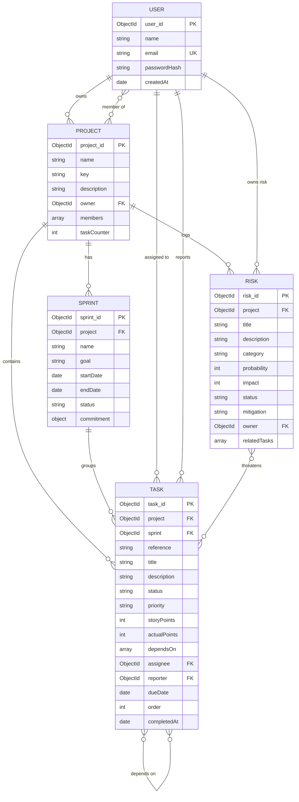

# Data Model

Predictive Sprint Planning & Delivery Risk Tool — Group 24, CSE, IIIT Vadodara

The system stores five entities: **User**, **Project**, **Sprint**, **Task** and
**Risk**. A printable TikZ version lives in `ER_Diagram.tex` (page 1 is the
logical schema, page 2 the conceptual Chen diagram).

## Entity–Relationship Diagram

## Relationships and cardinality

| Relationship | Cardinality | Notes |
|---|---|---|
| User *owns* Project | 1 : N | Exactly one owner per project; only the owner may rename, delete, or manage members. |
| User *member of* Project | M : N | Stored as an embedded `members[]` array on Project, not a join collection. |
| Project *has* Sprint | 1 : N | At most one sprint may be `active` at any time. |
| Project *contains* Task | 1 : N | Deleting a project cascades to its tasks and sprints. |
| Sprint *groups* Task | 0..1 : N | `sprint = null` means the task sits in the product backlog. |
| User *assigned to* Task | 0..1 : N | Nullable — an unassigned task is valid. |
| User *reports* Task | 1 : N | Mandatory; records who raised the task. |
| Project *logs* Risk | 1 : N | Risk register is scoped to one project. |
| Risk *threatens* Task | M : N | `relatedTasks[]` links a risk to the work it endangers. |
| Task *depends on* Task | M : N | Self-referencing DAG; cycles rejected at the API layer. |

## Why members are embedded rather than a join collection

In a relational design, `member of` would need a `project_members` join table.
MongoDB is a document store, so the array is embedded on the Project document
instead. This is the right trade-off here because:

- Members are **always** read together with their project — every board load
  needs the member list to populate the assignee dropdown. Embedding makes that
  a single read instead of a join.
- The array is **small and bounded**: this tool targets small teams, so a
  project holds a handful of members, nowhere near MongoDB's 16 MB document limit.
- Membership changes are **rare** compared to reads.

The index `{ 'members.user': 1 }` keeps "list every project I belong to" fast
despite the nesting.

## Field-level design decisions

**`Task.reference`** — a human-readable id like `ATM-14`, built from the
project's `key` plus its `taskCounter`. The counter lives on the Project
document and increments on each task creation, so references stay sequential
and gap-free per project.

**`Task.order`** — position within a Kanban column. Drag-and-drop rewrites the
whole destination column's order values in one bulk operation rather than
patching single indices, so concurrent drags cannot interleave into a corrupt
ordering.

**`Task.completedAt`** — maintained automatically by a `pre('save')` hook
whenever `status` changes: set when a task reaches `done`, cleared if it is
reopened. This is what makes the burndown chart computable from the Task
collection alone, with no separate history table.

**`User.passwordHash`** — declared `select: false`, so it is excluded from every
query unless explicitly requested. Login is the only place that asks for it.

**`Task.dependsOn[]`** — a self-referencing many-to-many edge list forming a
directed acyclic graph. Every write is checked with a depth-first search before
being accepted: a cyclic graph has no topological order, so the critical path
would be mathematically undefined. The API returns a 409 naming both ends of the
would-be loop.

**`Sprint.commitment`** — an immutable snapshot (`capturedAt`, `taskIds[]`,
`totalPoints`, `pointsByTask`) frozen the first time a sprint is activated.
Re-activating a sprint deliberately does **not** re-capture it. Without a frozen
baseline, scope creep is undetectable — the live task list always looks like the
plan, because it *is* the plan as amended.

**`Task.actualPoints`** — effort actually taken, recorded on completion. The
ratio against `storyPoints` is what drives estimation calibration; leaving it
null simply excludes that task from the accuracy sample rather than skewing it.

## Status vocabularies

| Field | Allowed values |
|---|---|
| `Task.status` | `backlog`, `todo`, `inprogress`, `done` |
| `Task.priority` | `low`, `medium`, `high`, `critical` |
| `Sprint.status` | `planned`, `active`, `completed` |
| `Project.members[].role` | `owner`, `member` |
| `Risk.status` | `open`, `mitigating`, `closed` |
| `Risk.category` | `technical`, `schedule`, `resource`, `external`, `quality` |

All are enforced as schema-level enums, so an invalid value is rejected at
the database layer regardless of which code path writes it. `Risk.probability`
and `Risk.impact` are additionally bounded to 1–5, giving an exposure score of
1–25 on the standard PMBOK risk matrix.
